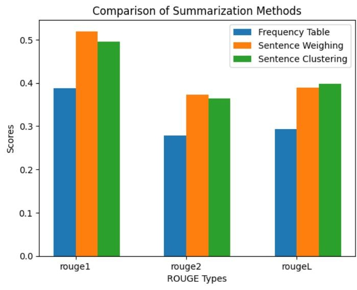
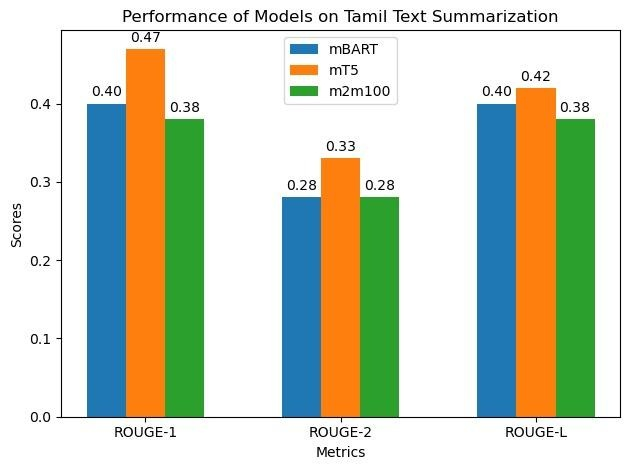

# Tamil Text Summarization

### Extractive methods and Transformer-based abstractive experiments.

**Python · Tamil NLP · mBART · T5 · Extractive summarization**

*Archived coursework / research prototype · Not actively maintained*

A semester 6 NLP project comparing extractive Tamil summarization methods and experimenting with pretrained sequence-to-sequence models. It includes clustering, sentence scoring/weighing, and mBART/T5 notebooks.

*Historical extractive-method comparison from the project report.*

## What is included

- Frequency-based sentence extraction
- Sentence scoring, weighting, and clustering scripts
- mBART and T5 fine-tuning experiments
- Historical ROUGE-comparison and distribution figures

The repository includes 6 directly browsable source/notebook files and a [source archive](source.zip) containing 6 files with their package structure preserved. See [SOURCE_INDEX.md](SOURCE_INDEX.md) for its contents. Reference components retain their labels and upstream notices.

## Workflow

*Diagram reconstructed from the recovered source or project description.*

## Preserved results and examples

*Historical mBART/mT5/m2m100 comparison from the project report.*

These are historical artifacts, not fresh executions. Where a report includes scores or rankings, their original evaluation protocol has not been independently reproduced.

## Explore / run

Open the notebooks and inspect dataset/model paths before running. The Tamil XLSum archive remains local and is not redistributed. The sentence-scoring and weighting scripts use legacy Python 2 print syntax and need migration for Python 3. Scripts may require external preprocessing libraries and compatible Transformers versions; no tested lockfile is claimed.

### Direct source files

- [mbart.ipynb](mbart.ipynb)
- [sentence_clustering.py](sentence_clustering.py)
- [sentence_scoring.py](sentence_scoring.py)
- [sentence_weighing.py](sentence_weighing.py)
- [tamil-text-summarization-extractive-approach.ipynb](tamil-text-summarization-extractive-approach.ipynb)
- [t5-fine-tuning.ipynb](t5-fine-tuning.ipynb)

## Project status

Figures are recovered from the end-semester report. They are reported historical comparisons, not rerun benchmarks. This project is separate from the later Phase 2 Malayalam summarization archive.

No training, benchmark, paid API request, or external service deployment was performed to prepare this showcase. Team names, student IDs, raw personal documents, and embedded credentials are excluded from the public upload copies. Additional scope notes are in [SOURCE_NOTES.md](SOURCE_NOTES.md).
